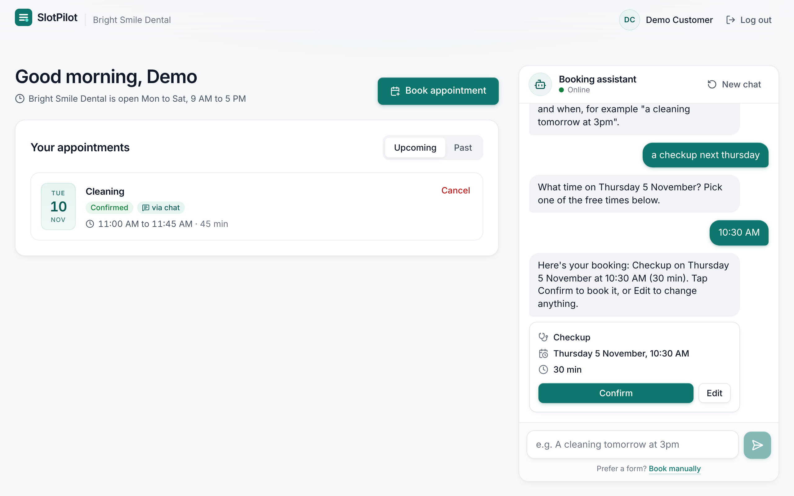
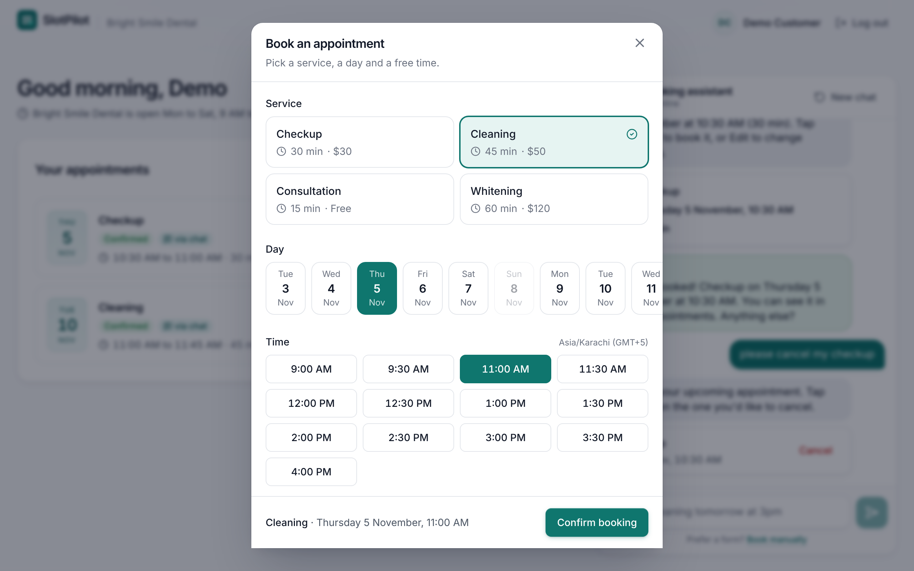
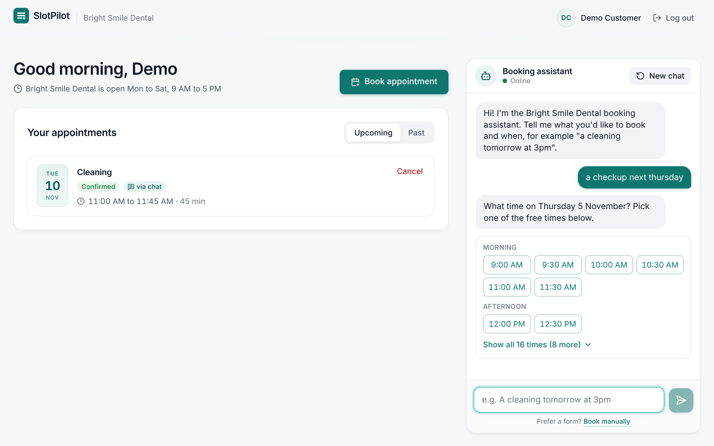
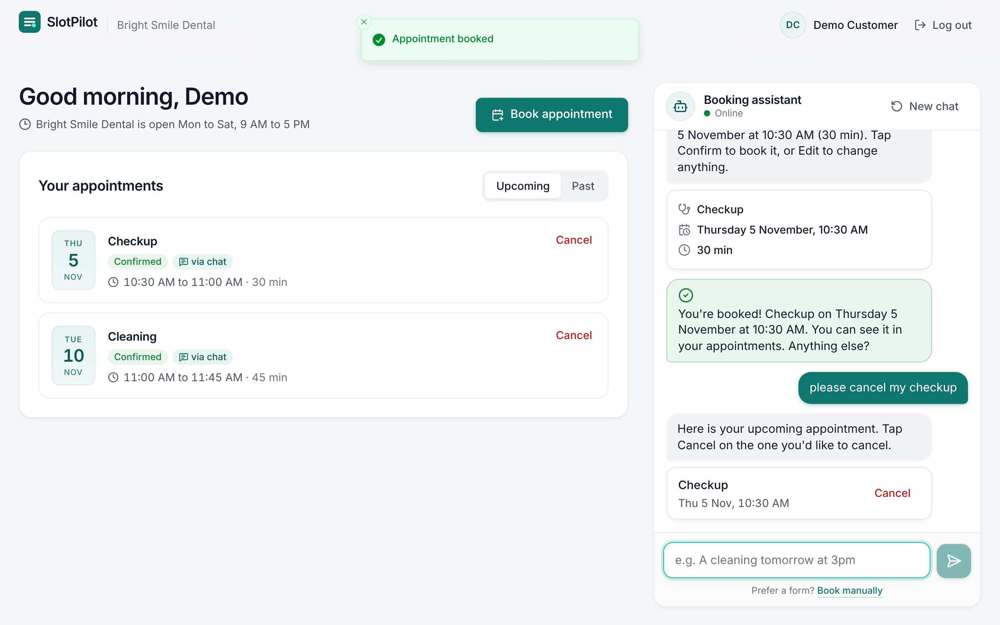
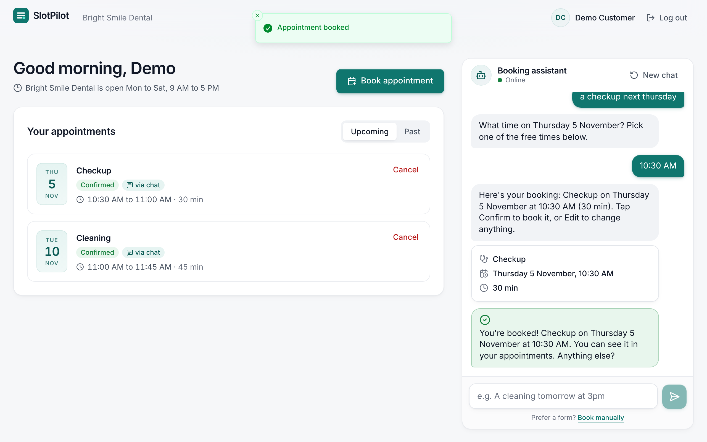
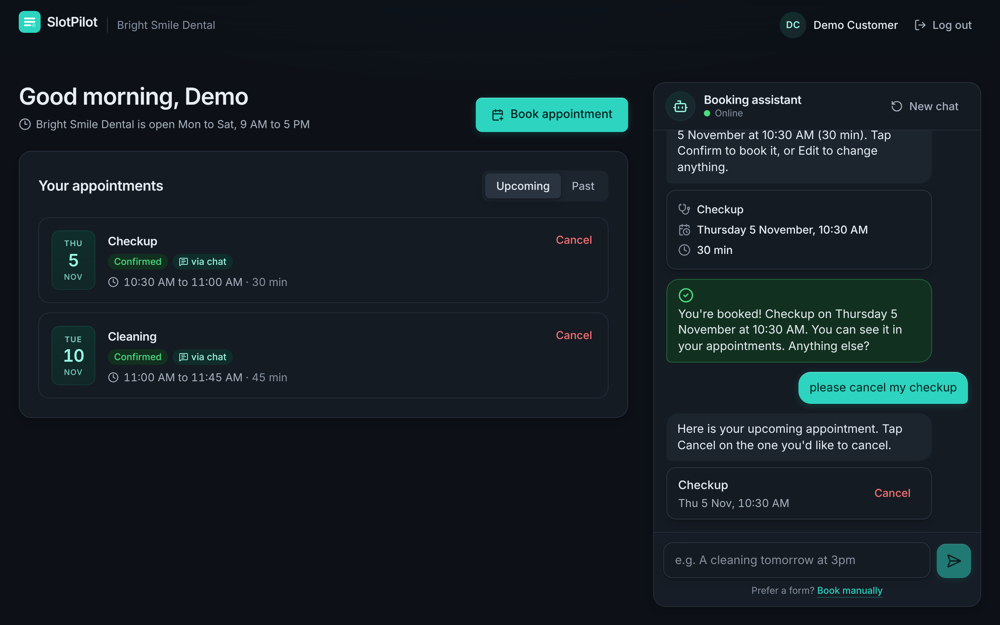
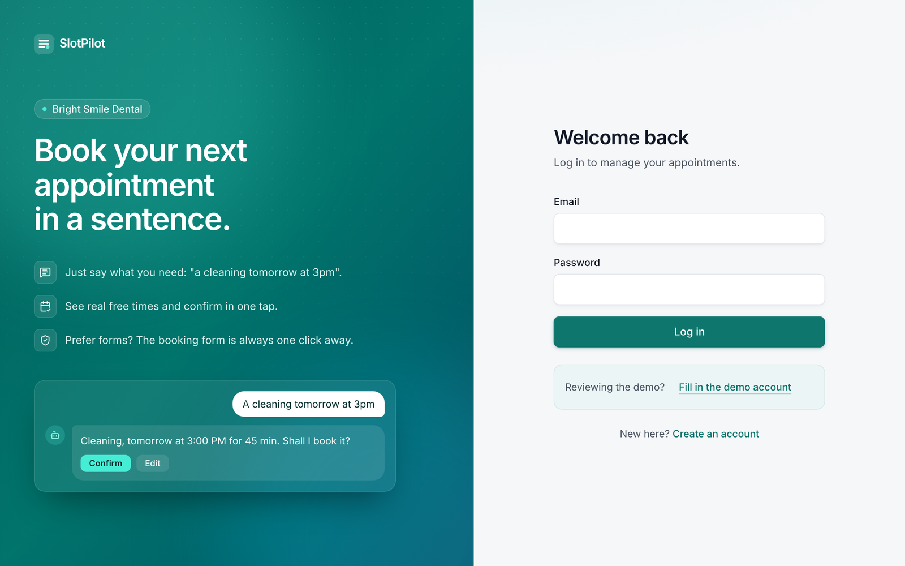
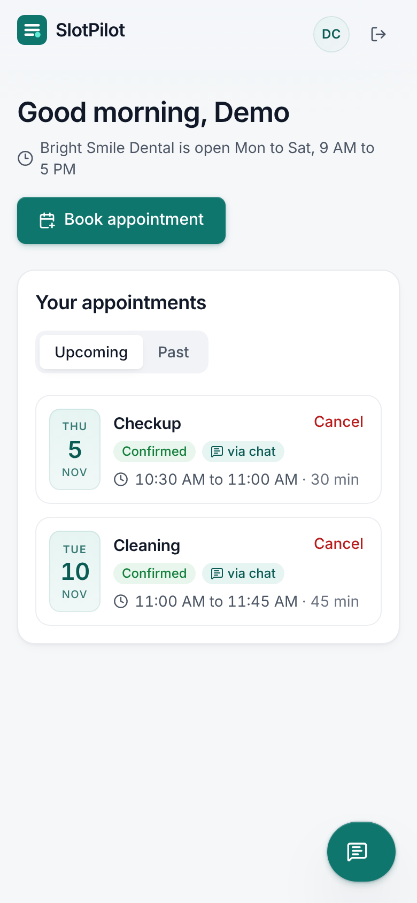
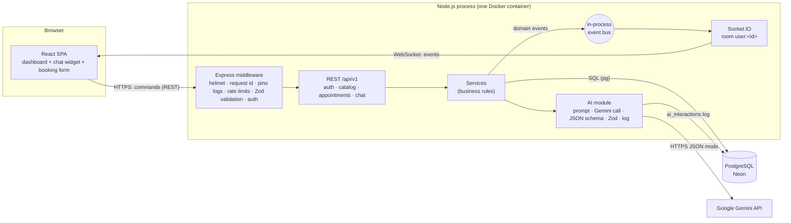
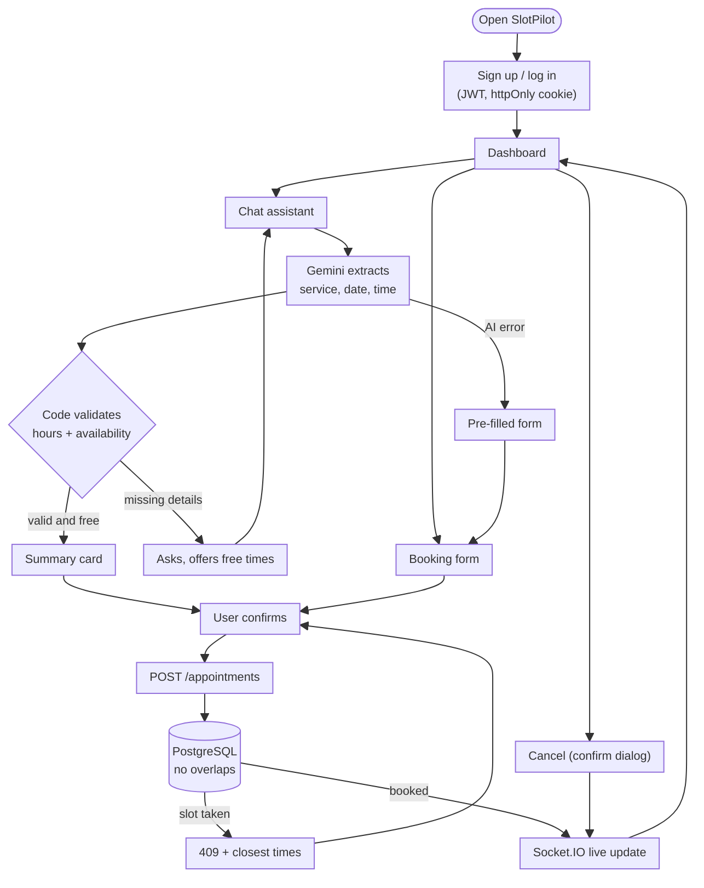

# SlotPilot

[](https://github.com/ProgrammingWithAbdullah/slotpilot/actions/workflows/ci.yml)

**AI-assisted appointment booking.** Customers book by chatting ("a cleaning tomorrow at 3pm") or with a
regular form. The assistant understands the request, asks for what is missing, checks real availability,
and books only after the customer presses **Confirm**.

- **Live demo:** [slotpilot.onrender.com](https://slotpilot.onrender.com) (free tier: the first request after idle can take about 50 s)
- **Demo login:** `demo@slotpilot.dev` / `Password123!` (the login page has a "Fill in the demo account" button, or sign up)

| Chat booking                                                         | Booking form                                                       |
| -------------------------------------------------------------------- | ------------------------------------------------------------------ |
|  |  |
|      |    |

<details><summary>More screenshots (dark theme, mobile, login)</summary>






</details>

**Docs:** [Architecture](docs/ARCHITECTURE.md) · [Flow diagrams](docs/FLOWS.md) · [API and AI integration](docs/API.md) · [Database](docs/DATABASE.md)

## What it does

- **Sign up and log in.** JWT in an httpOnly cookie, passwords hashed with bcrypt.
- **Dashboard.** Upcoming and past appointments, cancel with confirmation, live updates.
- **Embedded chat assistant** (Google Gemini):
  - Extracts service, date and time from free text across several messages ("cleaning please", then "tomorrow", then "3pm").
  - Validates everything in code: real service, open day, inside opening hours, not in the past, slot free.
  - Offers every free time of the chosen day in a compact picker, and the closest alternatives when a slot is taken.
  - Shows a summary card. Nothing is booked until the user presses **Confirm**.
  - Finds appointments to cancel ("cancel my cleaning on Friday"). The user presses Cancel and confirms.
  - Falls back to the booking form, pre-filled, when the AI fails, returns invalid output or the conversation stalls.
- **Booking form.** Service, day, free time, confirm. It uses the same endpoint and rules as the chat.
- **Real time.** Replies, the typing indicator and appointment changes are pushed over Socket.IO, with polling as a fallback.
- **Multi-tenant schema.** Every row belongs to a `business`, and double booking is impossible at the database level.

## Architecture



**REST for commands, WebSocket for events; the LLM proposes, the code decides.** The browser sends every command over
REST, where it is validated and rate limited, and the server pushes results over Socket.IO. Sending a chat message
returns `202 Accepted` immediately. The AI turn runs in the background, and the reply arrives as a `chat:message` event
(or via polling if the socket is down). Gemini only turns the text into candidate fields
(`{intent, fields: {service, date, time, notes}, reply}`). Deterministic code checks them against the real catalog,
opening hours and availability, writes the confirmation summary itself, and books only after the user confirms. The
model has no database access and cannot book anything.

More diagrams are in [docs/ARCHITECTURE.md](docs/ARCHITECTURE.md), and step-by-step user flows (login, booking,
cancelling, the assistant) are in [docs/FLOWS.md](docs/FLOWS.md).

### Repository layout

```
apps/
  api/            Express 5 + Socket.IO API (TypeScript)
    src/modules/  auth · catalog · appointments · chat · ai · realtime   (routes → service → repository)
    test/         unit + integration tests (real Postgres)
  web/            React 19 + Vite SPA (feature folders: auth · appointments · chat)
packages/
  shared/         Zod schemas, DTO types, error codes, socket event names: the API contract used by both sides
db/
  migrations/     001_init.sql: the DDL (tables, constraints, indexes, comments)
  seed.sql        sample tenant, services, demo user, appointments, a chat and an AI log row
e2e/              Playwright end-to-end tests
docs/             architecture, flows, API and AI, database, screenshots
```

## Flow diagram



## Tech stack

| Layer    | Choice                                                                                                                                    |
| -------- | ----------------------------------------------------------------------------------------------------------------------------------------- |
| Frontend | React 19, Vite 7, TypeScript, Tailwind CSS v4, Radix UI primitives, TanStack Query v5, React Router v7, react-hook-form, Socket.IO client |
| Backend  | Node 22, Express 5, Socket.IO 4, Zod 4, pg (raw parameterized SQL), pino, helmet, express-rate-limit, bcryptjs, jsonwebtoken, Luxon       |
| Database | PostgreSQL 16 (Neon in production): `citext`, `btree_gist` exclusion constraint, composite tenant FKs, BRIN log index                     |
| AI       | Google Gemini (`gemini-3.5-flash-lite`, fallback `gemini-flash-lite-latest`) via REST, JSON mode + response schema, temperature 0         |
| Testing  | Vitest + Supertest (API, real Postgres), React Testing Library + MSW (web), Playwright (e2e)                                              |
| Delivery | Docker (multi-stage), GitHub Actions CI, Render (web service) + Neon (Postgres)                                                           |

## Run it locally

**Prerequisites:** Node 22+, and Docker (for Postgres) or any Postgres 14+ you can reach.

```bash
git clone https://github.com/ProgrammingWithAbdullah/slotpilot.git
cd slotpilot
npm install

cp .env.example .env          # works as is with the mock AI
docker compose up -d          # Postgres on :5432 (also creates slotpilot_test and slotpilot_e2e)
npm run db:reset              # migrate + load sample data

npm run dev                   # API on :4000, web on http://localhost:5173
```

Log in with `demo@slotpilot.dev` / `Password123!`.

**AI provider.** `AI_PROVIDER=mock` (default) is an offline parser, so everything works without a key. For Gemini set
`AI_PROVIDER=gemini` and `GEMINI_API_KEY` ([free key](https://aistudio.google.com/apikey)).

| Script                                        | What it does                                                                             |
| --------------------------------------------- | ---------------------------------------------------------------------------------------- |
| `npm run dev`                                 | API (tsx watch) + web (Vite) together                                                    |
| `npm run db:migrate` / `db:seed` / `db:reset` | Apply migrations / load sample data / drop + migrate + seed (refuses in production)      |
| `npm test`                                    | API unit + integration tests, then web component tests                                   |
| `npm run test:e2e`                            | Builds the app and runs Playwright against a real server                                 |
| `npm run test:ai-live -w @slotpilot/api`      | Sends sample messages to the real Gemini API and prints the extraction                   |
| `npm run lint` / `typecheck` / `format`       | ESLint (with module boundary rules), `tsc`, Prettier                                     |
| `npm run build` && `npm start`                | Production build; start runs migrations, seeds an empty DB, serves API + web on one port |

Environment variables are documented in [.env.example](.env.example) and validated at boot
(`apps/api/src/config/env.ts`): the server refuses to start with a clear message if something is missing.

## Testing

| Level                   | Count | Covers                                                                                                                                     |
| ----------------------- | ----- | ------------------------------------------------------------------------------------------------------------------------------------------ |
| API unit                | 57    | Slot rules, draft merging, service matching, Gemini provider (model fallback, bad JSON), extractor, mock parser                            |
| API integration         | 67    | Every endpoint against a real Postgres: auth, validation, ownership, concurrent double booking (409), idempotency, rate limits, chat turns |
| Web component           | 15    | Auth forms, booking form and 409 handling, chat send and reply, confirm card, form fallback, time picker, cancel from chat                 |
| End-to-end (Playwright) | 5     | Book through chat and cancel, pick from all free times, demo login, anonymous API access rejected                                          |

All tests use the deterministic mock LLM. CI
([.github/workflows/ci.yml](.github/workflows/ci.yml)) runs lint, format check, typecheck, all tests against a Postgres
service container, the production build, Playwright, and a Docker image build.

## Deployment

One Docker image serves the API, Socket.IO and the built React app from the same origin (no CORS, first-party cookies,
simple WebSockets). On start it runs migrations, seeds the demo data **only if the database is empty**, then listens.

- **Render** web service (Docker runtime, health check `/health/ready`), auto-deploys from `main`. A
  [render.yaml](render.yaml) blueprint is included.
- **Neon** Postgres. Either the pooled or the direct connection string works: migrations automatically use the direct
  endpoint, because a transaction-mode pooler can't hold the migration lock.
- **Environment variables:** `NODE_ENV=production`, `DATABASE_URL`, `JWT_SECRET` (32+ random characters),
  `AI_PROVIDER=gemini` and `GEMINI_API_KEY`. The full list is in [.env.example](.env.example).
- **Check:** `GET /health/ready` returns `{"status":"ready","ai":"gemini"}`. Without a key it reports `"ai":"disabled"`
  and the chat hands users to the form.

## Design decisions and tradeoffs

| Decision                                                 | Why                                                                                    | Tradeoff                                                                |
| -------------------------------------------------------- | -------------------------------------------------------------------------------------- | ----------------------------------------------------------------------- |
| **LLM extracts, code decides, user confirms**            | Booking has consequences and model output can be wrong. Rules stay testable.           | Less "magic". Function calling fits better once there are many actions. |
| **JSON mode, response schema and Zod**                   | One predictable shape per turn, provider-agnostic, invalid output is caught and logged | Less flexible than tool calling.                                        |
| **Structured draft in the DB plus the last 10 messages** | Facts never fall out of the context window, and cost stays bounded                     | Very old small talk is forgotten.                                       |
| **Fallback to a pre-filled form**                        | Booking works when the AI is down, wrong, or the user prefers a form                   | Two UIs, but one endpoint and one set of rules.                         |
| **REST commands, Socket.IO events, 202 for chat**        | No long-held HTTP requests behind a slow LLM, multi-tab sync, polling fallback         | Multiple instances need the Socket.IO Redis adapter.                    |
| **Postgres exclusion constraint** against overlaps       | Race-proof: concurrent bookings cannot both succeed, whatever the app code does        | Postgres-specific. Multiple staff would add a `resource_id`.            |
| **Idempotency-Key** on bookings                          | Double clicks and retries return the first result                                      | One unique index per user.                                              |
| **Multi-tenant via `business_id` and composite FKs**     | The database itself guarantees related rows belong to the same tenant                  | The tenant comes from config today. Next: subdomain resolution and RLS. |
| **JWT in an httpOnly, SameSite=Lax cookie**              | No token in JavaScript, stateless, also authenticates the socket handshake             | No early revocation. Would add token versioning or refresh rotation.    |
| **React SPA and single-origin deploy**                   | Clear frontend/backend boundary, one container, no CORS                                | No SSR, which is not needed behind a login.                             |
| **Raw SQL** instead of an ORM                            | Full Postgres features (exclusion constraints, ranges) and transparent queries         | More mapping code.                                                      |
| **In-process AI turn** instead of a job queue            | No queue infrastructure for a prototype                                                | A crash mid-turn loses that reply (the session unlocks after 30 s).     |

The reasoning behind the main decisions is in [docs/ARCHITECTURE.md](docs/ARCHITECTURE.md#6-key-decisions).
