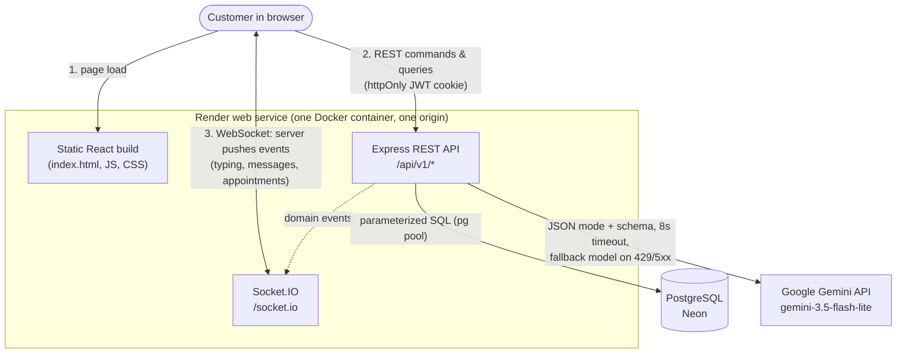
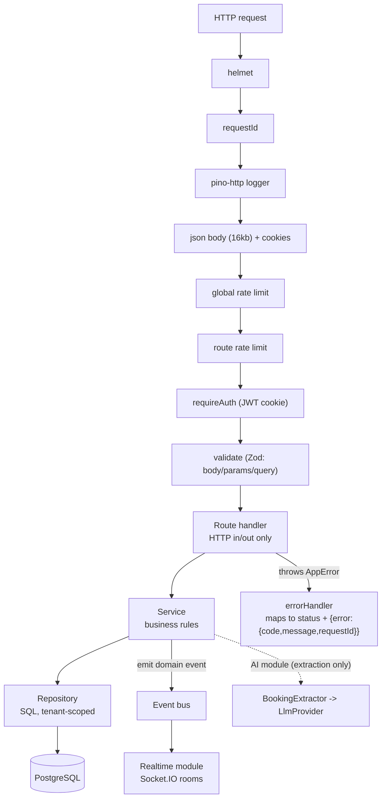
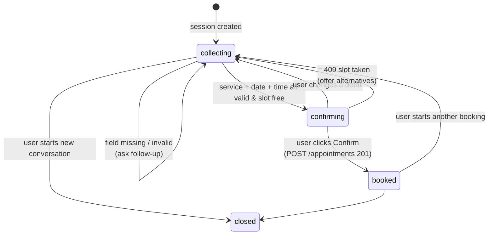
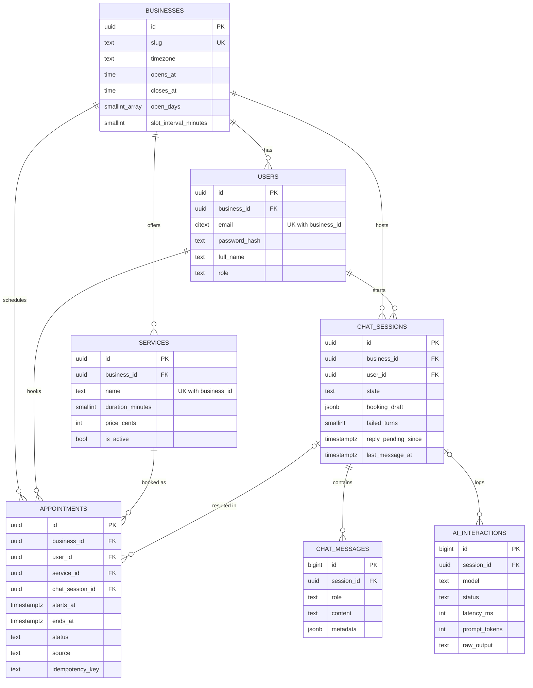
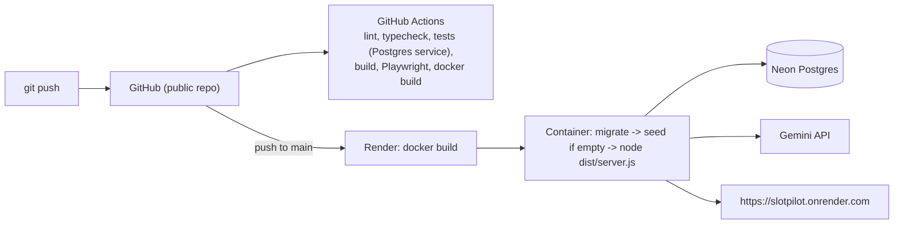

# Architecture

## 1. System context

The browser talks only to one Node process. That process is the only component that talks to the database and to Gemini, which is behind a swappable provider interface.

## 2. Backend layers

Every request passes the same middleware, then route, service and repository. Middleware handles security, logging and validation, so route handlers stay thin. Services hold the business rules. Repositories are the only place with SQL, and every repository method takes a `businessId`.

## 3. Chat session states

Each chat session has a state stored in the database. The server, not the model, moves between states.

## 4. Data model

Every tenant-owned table carries `business_id`, and composite foreign keys ensure related rows belong to the same business. Details in [DATABASE.md](DATABASE.md).

## 5. Deployment and CI/CD

From a push to the live URL.

## 6. Key decisions

**1. Monorepo with a shared Zod contract.** Frontend and backend need the same request shapes, validation rules, error
codes and event names. npm workspaces hold `apps/web`, `apps/api` and `packages/shared`, which contains the Zod schemas
and types used by the API for validation and by the web app for forms. The apps never import each other (ESLint
enforces it) and talk only over HTTP and WebSocket. _Trade-off:_ both apps release together, which suits a single deploy.

**2. The LLM extracts, code validates, the user confirms.** Booking has consequences, and models misread dates and invent
services. Gemini only returns `{ intent, fields, reply }` (JSON mode, response schema, temperature 0, validated with Zod).
Deterministic code checks service, day, hours and availability and writes the summary, and nothing is booked until the
user presses Confirm. Provider errors, invalid output or a stalled conversation hand over to the pre-filled form.
_Trade-off:_ less agentic. Function calling fits once the assistant has many actions.

**3. REST for commands, Socket.IO for events, polling fallback.** A chat reply depends on an LLM call that can take
seconds, and holding a request open for it is fragile. Every client action is a REST call, and sending a chat message
returns `202`. The server pushes `chat:message`, `chat:typing` and `appointment:*` events to the room `user:<id>`, and the
chat polls every 2 s if the socket is down. _Trade-off:_ the background turn runs in-process, so a crash mid-turn loses that
reply, and multiple instances need the Socket.IO Redis adapter.

**4. Double booking is prevented by a Postgres exclusion constraint.** Checking availability in code and then inserting is
a race. The constraint `EXCLUDE USING gist (business_id WITH =, tstzrange(starts_at, ends_at, '[)') WITH &&) WHERE
status IN ('pending', 'confirmed')` makes the database the final authority, and a violation maps to `409 SLOT_UNAVAILABLE`
with alternatives. An `Idempotency-Key` makes retries safe, and an integration test books in parallel to prove it.
_Trade-off:_ needs `btree_gist`, and multiple staff would add `resource_id` to the constraint.

**5. JWT in an httpOnly cookie, single-origin deployment.** Tokens in `localStorage` can be stolen through XSS, and separate
origins need CORS and cross-origin WebSockets. The JWT (HS256, 24 h) lives in an `httpOnly`, `SameSite=Lax`, `Secure`
cookie that also authenticates the socket handshake. Express serves the built React app, so the browser sees one origin.
Passwords use bcrypt (cost 12). _Trade-off:_ tokens cannot be revoked before they expire. A token version or refresh
rotation would fix that.

**6. Raw SQL with a small migration runner instead of an ORM.** The model relies on exclusion constraints, range types,
composite tenant foreign keys, partial and BRIN indexes and `citext`, which ORMs handle poorly. Migrations are plain SQL
files run by a small runner (ordered, one transaction per file, advisory lock). Repositories use parameterized `pg` queries
scoped by `business_id`. _Trade-off:_ more mapping code and no compile-time SQL checking. Kysely would add typed queries.
