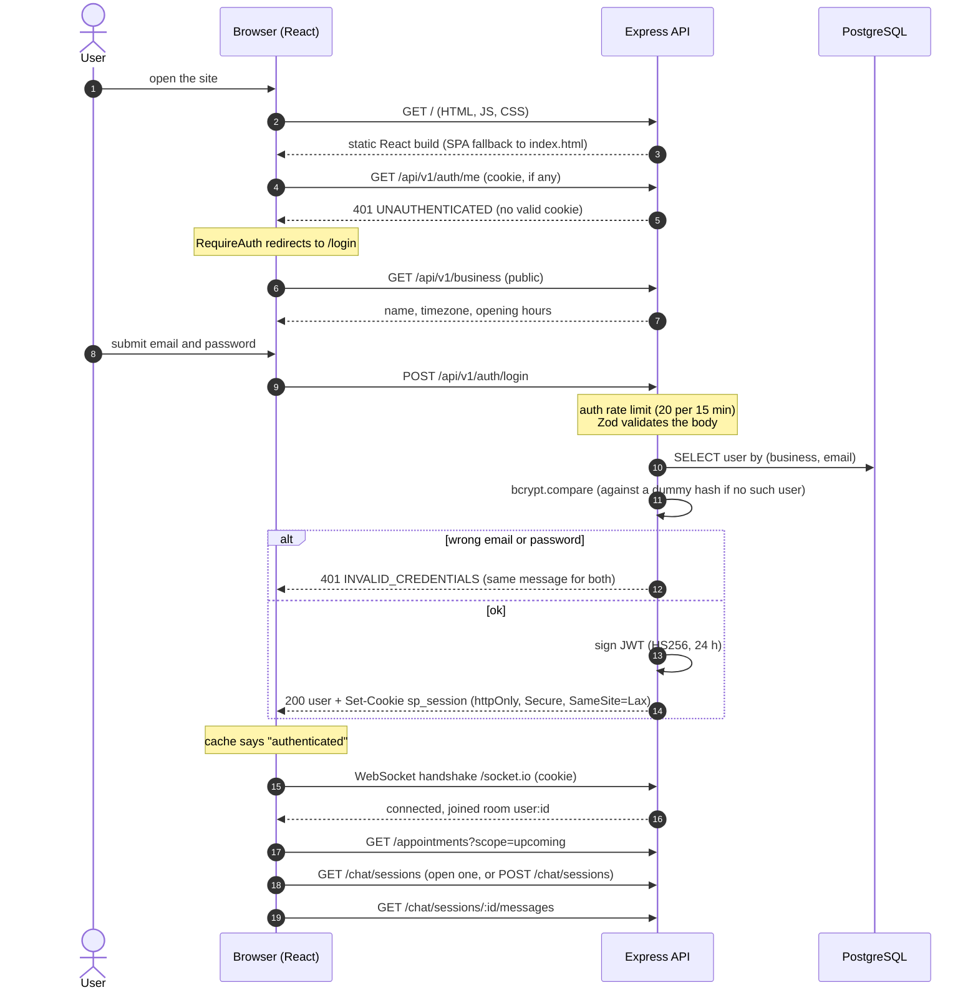
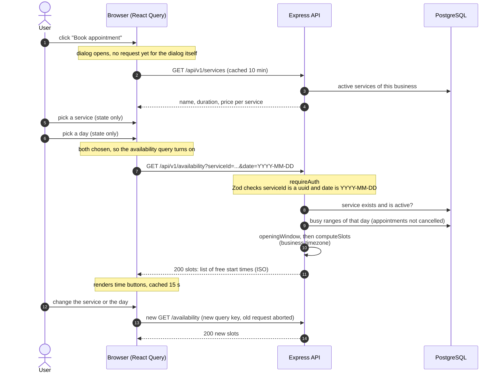
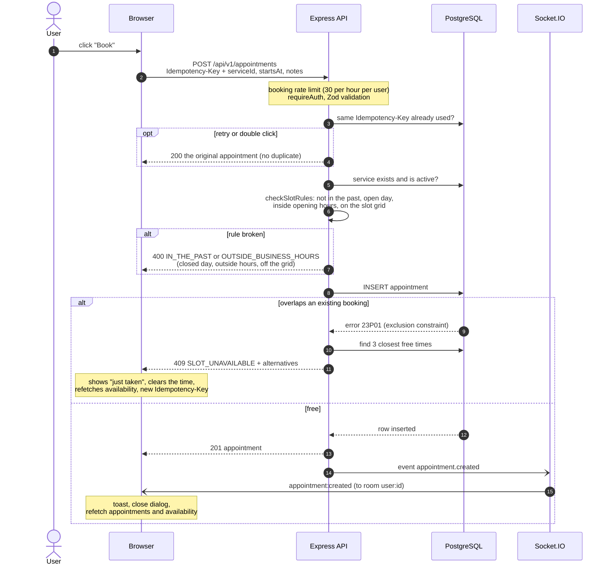
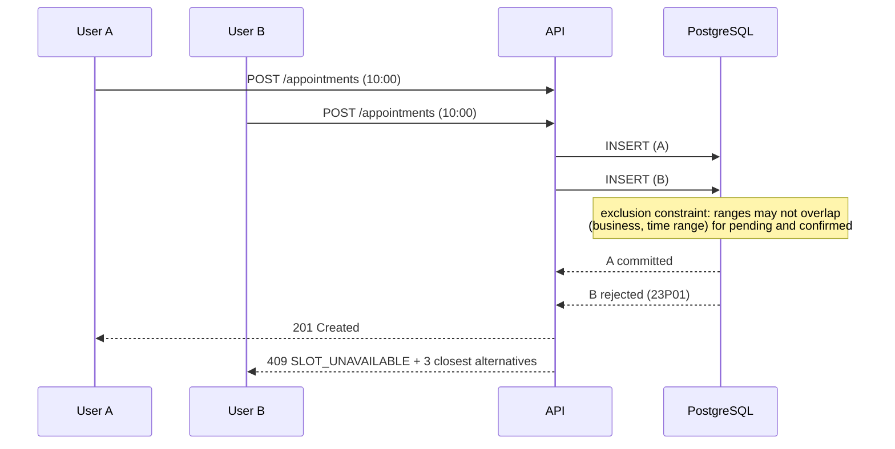
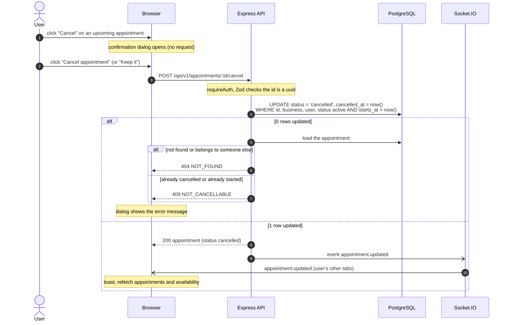
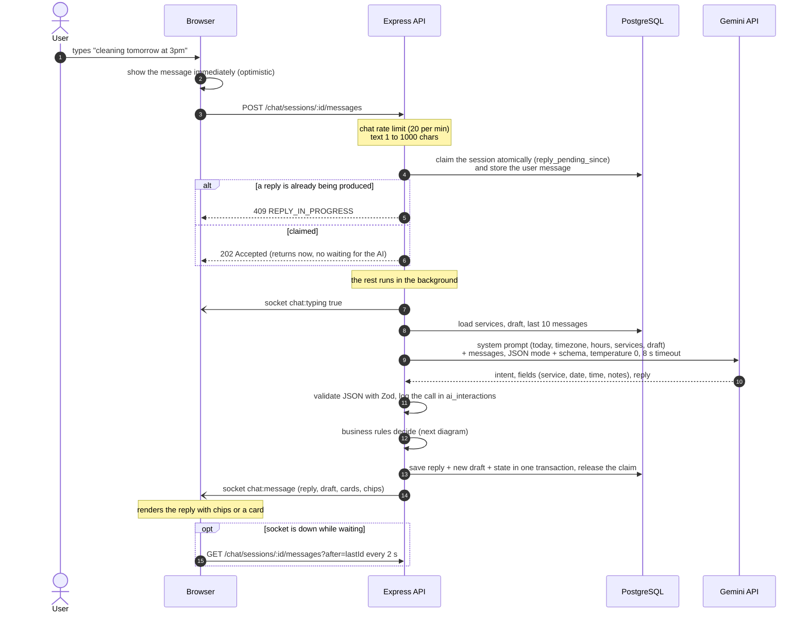
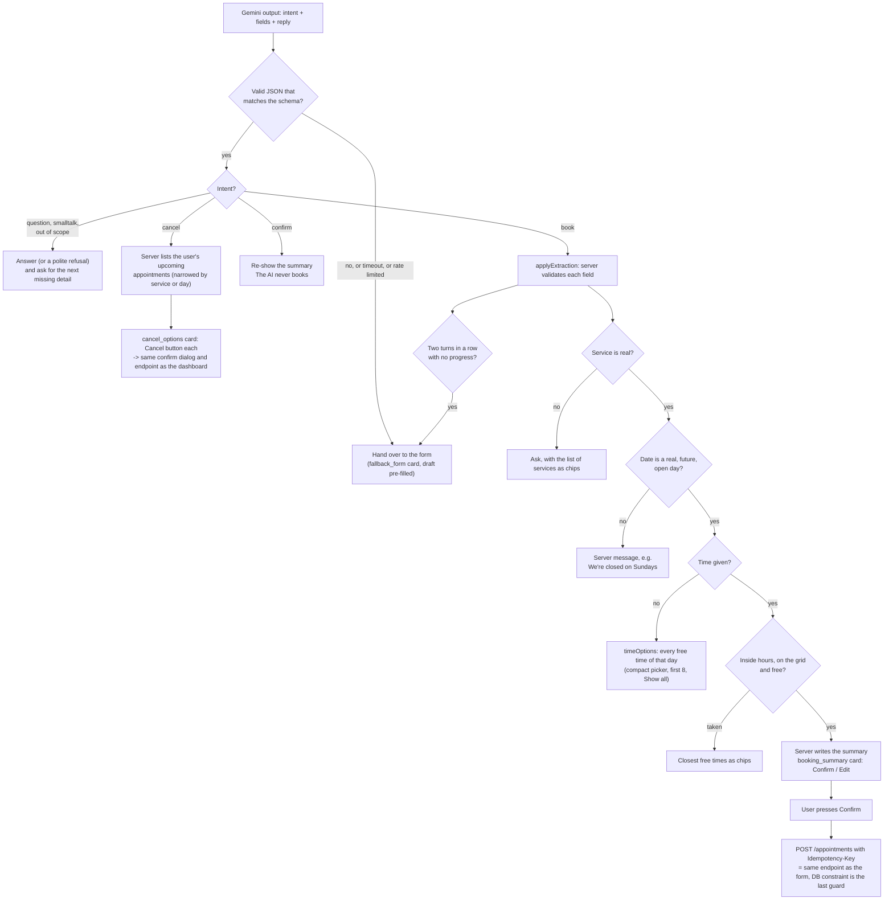

# Flow diagrams

| Transport                     | Used for                                                                                 |
| ----------------------------- | ---------------------------------------------------------------------------------------- |
| REST over HTTPS (`/api/v1/*`) | Every command and query: log in, list, availability, book, cancel, send a chat message   |
| WebSocket (Socket.IO)         | Server to browser only: typing indicator, the assistant's reply, appointment changes     |
| Polling (every 2 s)           | Fallback for chat replies, only while a reply is pending and the socket is not connected |

The browser never sends commands over the socket, so every change goes through one validated, rate-limited endpoint.

---

## 1. Opening the app and logging in

- The session token is a JWT in an `httpOnly`, `SameSite=Lax` cookie (`Secure` in production). The frontend and API share
  one origin, so no CORS is needed.
- `GET /auth/me` decides who is logged in. Its cached result is the auth state, and the route guard waits for it.
- Wrong email and unknown email return the same `401 INVALID_CREDENTIALS`, and a dummy bcrypt comparison keeps timing equal.
- The Socket.IO handshake reuses the cookie and each socket joins only its own room, `user:<id>`.

---

## 2. Manual booking: choosing a service and a day

`GET /availability` validates the query, loads the service (`404` if unknown) and computes the free start times:

1. Find the opening window for the date in the **business timezone**. A closed weekday gives an empty list.
2. Read the day's busy ranges from `appointments` (pending and confirmed).
3. Step through the window every `slotIntervalMinutes`, keeping a start time only if the whole service fits before
   closing, is not in the past and does not overlap a busy range.

Availability is computed per request, so there is no slot table to keep in sync. The result is a hint; the database
constraint in flow 3 is the real guarantee. Changing the service or day changes the React Query key and fires a new
request (the previous one is aborted). Only REST is used on this screen.

---

## 3. Confirming a booking

Two users booking the same slot at the same moment:

- Double booking is prevented by a PostgreSQL exclusion constraint on `(business_id, tstzrange(starts_at, ends_at, '[)'))`
  for pending and confirmed rows. The check and the insert are one atomic step, and the loser receives `23P01`, mapped to
  `409 SLOT_UNAVAILABLE` with the closest free alternatives. See [Key decisions](ARCHITECTURE.md#6-key-decisions).
- `Idempotency-Key` makes a retried or double-clicked request return the original booking (`200`) instead of a duplicate.
- Status codes: `201` created, `200` replay, `400` validation or business rule (`IN_THE_PAST`, `OUTSIDE_BUSINESS_HOURS`),
  `401`, `409` slot taken, `429` rate limited.
- The form and the chat's Confirm button call the same endpoint and service, so the rules cannot diverge.
- The `appointment.created` event reaches the user's own room, which keeps their other tabs in sync.

---

## 4. Cancelling an appointment

- Cancelling is a single conditional `UPDATE` (yours, still active, in the future), so there is no read-then-write gap.
  The row is kept with `status = 'cancelled'` for history.
- Another user's appointment returns `404`, so the API does not reveal that the id exists.
- The exclusion constraint only covers pending and confirmed rows, so a cancelled time becomes bookable again.
- The dashboard and the chat use the same confirmation dialog and endpoint.

---

## 5. The AI assistant

### One chat turn

- The POST returns `202` immediately and the reply arrives over the socket, so no HTTP request waits on the model.
- The session is claimed with one atomic `UPDATE ... WHERE reply_pending_since IS NULL OR older than 30 s`; a second
  message in the meantime gets `409 REPLY_IN_PROGRESS`. No lock is held during the model call.
- Memory has two layers: a structured **draft** on the session (service, date, time, notes) owned and validated by the
  server, and the **last 10 messages** sent to the model.
- Gemini is called in JSON mode with a response schema, `temperature: 0` and an 8 s timeout. A second model is tried on
  429, 5xx, 404 or timeout. The output is validated with Zod, and every call is stored in `ai_interactions`.

### Who decides what

The model proposes, the code decides and the user confirms.

Fallback to the booking form (pre-filled with the draft):

| Reason           | Trigger                                               |
| ---------------- | ----------------------------------------------------- |
| `ai_error`       | Timeout, 429 or 5xx on every configured model         |
| `invalid_output` | Not JSON, or does not match the schema                |
| `no_progress`    | Two booking turns in a row that added no valid detail |
| `ai_disabled`    | No `GEMINI_API_KEY`; the app works form-first         |

The browser also offers "Check again" and "Use form" if no reply arrives within 25 s.
